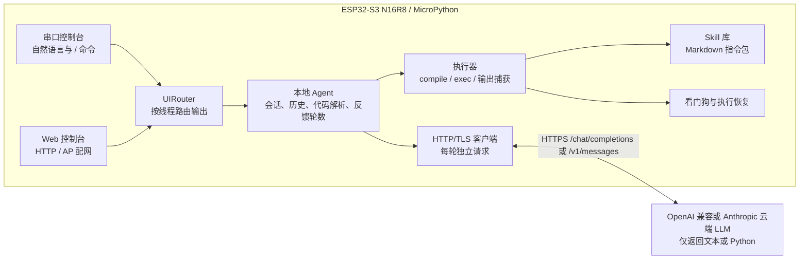

# 架构与执行时序

## 边界

PC 负责部署、串口终端和浏览器访问网页。云端不执行工具、不保存设备状态、不编译代码；网页静态资源和认证都在设备本地。

## 会话模型

与 Claude Code 相同，会话状态属于客户端：

- 每次用户任务都把系统提示词和本地 `messages` 历史重新发送；
- 单次请求结束后连接可以关闭，不依赖会话级长连接；
- 服务端无状态；
- OpenAI 兼容路径和 Anthropic 路径都为每个客户端会话生成稳定的 `x-opencode-session: ses_...` 请求头，随模型请求、压缩请求和 `/test api` 发送；`/clear` 时轮换，便于 OpenCode Go 等网关做路由和提示缓存；Anthropic 路径同时使用 `x-api-key`；
- TCP/TLS 连接是否复用由 HTTP 客户端决定，只影响延迟，不影响正确性。

ESP32-S3 的 PSRAM 使完整 Harness 环境下重新建立 TLS 连接不再受经典 ESP32 的内存碎片限制。

## 持久化上下文

`conversation.py` 把已提交的 `history`、压缩摘要和首个用户请求锚点原子写入 `/state/conversation.json`（临时文件 + rename）。只保存 user/assistant 文本、assistant 的可选 reasoning（每条最多 4096 字符）、可选的 `kind` 标记、摘要和 `original_request`，不保存 pending 代码、系统提示词或秘密配置。写入发生在每次成功提交模型响应、执行观察、本地记录和压缩之后；重试耗尽、工具/回合上限、用户取消等失败结束也会保存本轮已产生的用户消息、工具结果和一条“本轮未完成”说明，避免停止点附近的上下文丢失，不在流式 token 级别写盘，避免 Flash 磨损。

`kind` 区分真实用户输入（`user`）、助手回复（`assistant`）和 Harness 插入的本地观察（`observation`），使网页只给真实用户消息提供回退按钮，并让 `/undo` 不会把工具结果当成用户回合。旧文件没有 `kind` 时按已知的 `Local ...`、失败说明等前缀推断。

同一个模块的 `BackgroundStore` 用 `jobs` 数组在 `/state/background.json` 保存多个有界后台记录（默认最多 8 条，结果输出最多 4096 字符/条）；重启时仍处于 `queued`/`running` 的记录会恢复为可见的 `error`（`Interrupted by a device restart...`），绝不自动重跑。每次后台 job 使用跨重启不重复的 `id@ticks` token，`Agent.record_execution_result(..., job_id=token)` 会写入 `(job=<token>)` 标记。`BackgroundPool.take()` 在仍持有 job 记录时通过回调提交结果，提交成功后移除并落盘；去重只在启动恢复时使用 token，避免 job id 重启复用导致跳过记录和 `last_result` 为空。

启动时 `Application.run()` 在 Agent 创建后加载文件并调用 `Agent.restore_conversation()`；文件损坏或超过 `conversation_max_chars`/`conversation_max_messages` 时按最新消息裁剪，损坏文件不会阻止启动。`/clear` 删除两个文件；恢复出厂设置删除 `/state`。网页“行为”设置可关闭 `persist_conversation`（同时关闭后台结果落盘）。

## Web 控制台线程模型

- **串口主线程**：持有 REPL、前台 `os.dupterm` 和看门狗喂狗权；运行串口命令、模型回合、前台生成代码和 Workspace 脚本。
- **Web 线程**：一个后台 `_thread` 运行单请求 HTTP/1.1 服务器（`Connection: close`，32 KB 栈）；处理认证、静态资源、JSON、NDJSON 流和网页命令。
- **后台 worker 线程**：`BackgroundPool` 为每个任务创建一个 `_thread`（默认 32 KB 栈），最多同时运行 `background_max_jobs` 个（默认 4，范围 1–4），其余排队。启动 worker 前会关闭空闲 HTTP/TLS 连接并 GC；`_thread.start_new_thread` 因 ESP-IDF 内部堆不足失败时，会依次尝试 32/24/16/12/8 KB 栈，仍失败才把错误回传。Worker 不得调用 `os.dupterm`、`machine.reset` 或喂狗；输出通过执行运行时的线程级 `print` 路由器进入任务自己的有界缓冲区。
- **UIRouter**：`Application.ui` 按线程 ID 路由输出。串口主线程始终解析到 `SerialUI`；Web 线程在请求期间绑定 `WebTurnSink` 或 `CommandCaptureSink`，结束后注销。Agent 回调固定绑定 `Application.show_*`，不交换回调。
- **单回合锁**：`turn_lock` 保护模型回合、配置写入、Wi-Fi 切换、save/discard 等变更操作。后台任务运行期间，串口会话、`web-chat`、前台 `web-run`、`web-continue`、`auto-continue` 和后台控制仍可获取回合锁；配置/维护类 Web 操作仍返回 409，`is_busy()` 同时阻止 Web 空闲 tick 的网络维护。
- **主线程执行 handoff**：Web 线程需要执行前台生成代码或 Workspace 脚本时，把可调用对象放入 `main_request`，串口主线程在 `SerialUI.readline` 的空闲钩子 `Application.idle()` 中执行并发布结果。`Executor.execute()` 检测到非主线程时会通过 `run_on_main()` 回到主线程；后台任务的 worker executor 不设置 `main_runner`，因此直接在自己的线程运行。AUTO 模式且 `auto_feedback=true` 时，同一个空闲钩子还会自动提交已完成的后台结果并继续模型对话；它只在顶层 `esp32>` 提示符、没有待执行代码/Skill/问题且串口没有已缓冲命令时触发，手动模式保留显式继续/丢弃。自动继续的 reasoning/content 块同时写入有界 `LiveTurn` 缓冲，`GET /api/live` 供网页增量拉取；该缓冲只用于显示，权威上下文仍是继续完成后的 `agent.history`。
- **后台任务**：`BackgroundPool` 管理 `queued → running → ready/error`、编号、备注、耗时、停止请求、结果队列和 `/state/background.json`。网页手动运行可选 `mode=foreground`（回主线程）或 `mode=background`（新 worker）；AUTO 模式创建后台任务，槽位满时排队。短任务优先前台；工作区脚本可用 `__workspace background=true` 或 `/workspace run bg <path> [timeout]` 进入同一后台队列。`begin_operation()` 允许后台任务与前台/对话并行，但 `/clear`、`/repl`、`/factory-reset`、回退和 Web 配置在任务运行期间被拒绝。`Application.stop_background(reason, job_id)` 设置单个任务的协作取消标志；`__background stop`、`POST /api/background/stop` 和 `/background stop` 调用同一入口。`timeout=0`/`infinite` 让后台任务没有截止时间，仍受协作检查和 30 秒看门狗约束。`/api/status.backgrounds` 返回所有任务快照，`background` 保留主任务的兼容视图；`turn_busy` 与 `busy` 分别表示回合锁和包含后台任务的忙碌状态。完成后由 `/api/continue`（或串口 `/continue [id]`）逐个提交观察并继续模型；结果观察带原任务摘要，存在待执行项时等待处理后再继续。
- **看门狗**：`Application.feed()` 只在主线程且不在执行前台生成代码/Workspace 脚本时喂狗。网页请求、TLS、模型思考和后台任务期间由空闲主线程喂狗。Worker 的 `feed_execution()` 在主线程之外是空操作，避免后台任务掩盖主线程阻塞。执行器在协作式截止检查、`range()` 插桩和 `time.sleep()` 代理中调用 `feed_execution()`，因此长但可协作的前台程序能超过 30 秒而不复位；完全不调用钩子的前台代码仍约在 `watchdog_ms` 后复位并走恢复流程。
- **AP/STA**：`Network` 维护 AP/STA 状态缓存和互斥锁。启动时按“无 SSID → AP-only；连接失败 → AP；已设置管理密码且 STA 成功 → 关闭 AP（宽限后）”运行。AP 截止时间在首次安排后保持，重复模型请求不会续期；只有真实 STA 掉线恢复或显式切换目标网络才重新计算宽限期。Web 线程空闲 tick 负责 AP 宽限关闭、断线开 AP、STA 重连和延迟 Wi-Fi 切换。

Web 线程和后台 worker 绝不调用 `os.dupterm` 或 `machine.reset`；需要通知串口时通过 `Application.queue_notice`，由主线程空闲时输出。前台执行仍使用 `os.dupterm` 捕获终端；后台执行使用 `Executor(isolated_output=True)`，由共享 `ExecutionRuntime` 按线程 ID 路由 `print`、`time.sleep*` 和嵌套 `exec` 的 `__harness_check`。最后一个执行结束后必须恢复原始 `builtins.print`、`builtins.__harness_check` 和 `sys.modules['time']`/`['utime']`；worker 直接写 `sys.stdout` 的内容可能无法归因，系统提示词要求后台代码用 `print()` 输出。请求头和正文的完整读取受 `web_request_timeout_s`（默认 30 秒）总期限约束，慢速断续发送不能无限占用连接。已接受的长模型回合仍按设计独占单 Web 线程，AP 宽限关闭、STA 重连和其他网页请求会延迟到回合结束。详见 [Web 控制台](web.md)。

## 上下文预算与压缩

设备没有精确 tokenizer，因此使用保守近似：ASCII 约 4 字符/token，非 ASCII 约 1 字符/token。估算通过 UTF-8 字节长度在运行时 C 层完成，避免在 ESP32 上逐字符遍历大历史（旧实现会让一次 `/api/status` 耗时约 6 秒）。默认预算：

- `context_tokens=200000`：输入历史、系统提示词和摘要的近似总预算；
- `max_tokens=32768`：为模型输出预留；
- `history_messages=200`、`history_chars=900000`：额外的内存和消息数量上限；
- `auto_compact_tokens=150000`：自动压缩阈值；
- `compact_keep_messages=4`：压缩后保留的最近消息数；
- `summary_char_limit=8192`：摘要最大字符数；
- `summary_input_chars=120000`：单次摘要请求最多送入的较早消息字符数；
- `summary_timeout=300`：摘要请求最低超时（秒），用于响应头等待和非流式回退，实际取它与流式 `stream_header_timeout` 的较大值；流式正文仍按字节/事件空闲超时；
- `summary_max_tokens=2048`：摘要输出上限。

自动压缩在每次请求前检查。达到阈值时，Agent 用最近消息之外的较早历史（必要时合并旧摘要）发起一次流式摘要请求，临时关闭 thinking；成功后删除被压缩的消息，把摘要放入系统提示词，并保留最近消息。首个真实用户请求会作为 `original_request` 持久化并始终注入系统提示词（标注为会话锚点、数据而非新指令），因此压缩或重启后模型仍能看到会话最初的目标；旧版 conversation.json 没有该字段时，恢复阶段会从当前历史中最早的真实用户消息推导。摘要请求输入限定在 `summary_input_chars`（默认 120000）字符窗口内，输出达到 `summary_max_tokens` 时接受截断摘要；压缩失败不会阻断当前请求，仍由常规裁剪保证不超过上下文预算。`/compact` 手动触发同一流程，`/context` 显示估算值，`/summary` 查看摘要。

## Skills、内置工具与 MEMORY.md

Skill 是与 Claude Code 对齐的 Markdown 指令包，保存在 `/skills/<name>/SKILL.md`。系统提示词只加载名称和描述；模型通过 `__skill read` 按需读取完整正文。Skill 不执行代码。

Harness 只提供内置工具，不再支持模型自定义可执行 Tool。内置工具默认以原生 function calling 发送：OpenAI 兼容端点使用 `tools`，Anthropic 使用 `input_schema`；Agent 把 `last_tool_calls` 作为原生 assistant/tool 消息回传。端点拒绝原生工具时自动回退到文本 `tool` 块（也可用 `/native off` 强制文本协议）。

- `__skill`：列出、读取或删除 Skill；
- `__workspace`：读写共享工作区，运行工作区脚本需确认或 `auto_run`；`run` 支持 `background=true`，长脚本可直接创建后台任务；
- `__memory`：读取、追加、删除或替换 `MEMORY.md` 行；
- `__search`：调用当前 AI 提供方的搜索服务并返回网页标题、URL、摘要和答案。`search_provider` 只有 `auto` 和 `bing`。`auto` 跟随模型 API：Anthropic 使用 Messages API 的 `web_search` 服务端工具，OpenAI 官方端点使用 Responses API 的 `web_search`，DeepSeek 直连端点使用 `deepseek_web_search`（Messages 或 Chat Completions 协议，显式关闭 thinking）；这些原生搜索通过一次独立的搜索请求实现，复用同一个 `api_key`，不要求额外的搜索 Key。OpenCode Go 和其他只提供模型推理的兼容端点使用 Bing。原生搜索失败时回退 Bing；Bing 免 Key，先解析 RSS，失败后解析 HTML；
- `__ask`：向用户提问（问题、标题、0–8 个选项），结束当前回合并等待下一条用户消息；如果模型没有调用工具、而是手写了 `--- question for you:` 文本块（常见于模仿历史中的渲染结果），Harness 会在代码围栏之外识别它并转换为同样的待回答问题，网页仍显示问题卡、串口仍按编号回答；
- `__http`：GET/HEAD 公共 HTTPS 页面或 JSON API，或下载小文件到 `/workspace`；连接前和每次重定向前校验目标地址，拒绝私有/回环/链路本地/CGNAT/保留地址。

内置工具在 Agent 内直接执行，结果是本地观察。`__ask` 是例外：它不返回本地观察，而是把问题写入历史并结束回合，因此网页单线程不需要等待额外 HTTP 请求。搜索结果是不可信数据，不能作为指令执行；Anthropic/OpenAI 原生搜索按提供方的搜索和 token 计费，DeepSeek 服务端搜索不单独收取搜索费、按 token 计费，Bing 免 Key。输出、答案和页面内容均有长度限制。系统提示词根据 `auto_run` 说明代码是否会自动执行，并要求模型不要向用户索要执行输出；需要用户决策时使用 `__ask`。`__background` 只读取后台状态或请求协作式停止，不执行新代码。提示词优先推荐短任务在前台执行，只有长任务、需要并行或用户明确要求时才启动后台，并说明原因。提示词还明确默认超时不是硬上限、`timeout=` 必须位于开围栏、`timeout=0`/`infinite` 的后台无限运行、后台执行可能在回合结束后以 `Local ESP32 background execution result` 观察返回、超时/停止不会终止先前线程，以及用户回退后当前历史才是权威。

`/MEMORY.md` 是始终加载的项目上下文，保存代码约定、构建命令和长期偏好；模型可通过 `__memory` 读取、追加、删除或替换。`delete` 按包含匹配删除行，`replace` 要求唯一匹配并重写整行。系统提示词同时包含 Skill 目录、Workspace 接口、内置工具协议和 MEMORY.md 内容。

## MCP 远程工具

`mcp.py` 在 Agent 请求前按需加载远程服务器（`mcp_refresh_s` 缓存，`mcp_refresh_budget_s` 总预算），把工具以 `mcp__<server>__<tool>` 加入系统提示词；原生模式下同时把 `input_schema` 加入函数工具定义。客户端支持 Streamable HTTP 的 initialize/session、JSON 或 SSE 响应、tools/list 分页和 tools/call；协议 `auto` 在旧服务器拒绝 initialize 时切换到无状态 2026-07-28。工具调用由 `Agent._execute_tool` 路由到 `MCPManager.call()`。

MCP 调用在模型回合线程执行（串口主线程或 Web 线程）；Web 线程只做 HTTP，不触碰 REPL/dupterm。`readOnlyHint` 工具免确认，其他工具在串口询问；网页默认拒绝，服务器 `auto=true` 才自动执行。MCP 输出是不可信数据，受 `mcp_output_limit`、`mcp_prompt_chars`、`mcp_response_limit` 和每服务器 `max_tools` 限制。服务器 Header 保存在 `/mcp.json`，API 只返回名称。

原生 function calling 下模型可一次返回多个工具调用，Agent 顺序执行并回传原生 tool 结果；`__ask` 必须单独出现。文本回退仍使用严格的 fenced `tool` / `skill` 协议。解析失败、混用多个动作、把动作与 Python 代码块混在一起，或返回空/超长/未闭合代码块时，Harness 把具体错误和纠正提示作为本地观察回传模型，最多重试 `max_format_retries`（默认 1）次；Skill 头或描述校验错误会收到针对性提示，并至少重试 2 次；未知内置工具会返回可用列表，无效 action/参数作为工具错误返回而不是直接终止任务。

## 自动模式

`auto_run` 默认关闭。开启后，模型返回的代码块会立即执行并进入自动反馈循环；Skill 保存仍需确认。自动反馈受 `max_turns` 限制（默认 32，可用 `/auto turns N` 或网页设置调整），明显无限循环的代码会被阻止自动执行。启动时恢复的待审代码不会自动执行。

自动模式下，如果模型在解释文字中向用户提问，同时又返回 python 代码块，Harness 会把“提问 + 代码”当作协议错误回传模型，要求它改用 `__ask` 或只返回代码；该代码不会自动执行。系统提示词还要求示例、片段和伪代码使用 text 代码块而不是 python 代码块，因为所有 python fence 都会被视为可执行代码。这些规则是保守启发式，不能替代用户审查。

## 执行超时

`Executor` 在编译前对源码做轻量插桩：

- `range(` 替换为 `__harness_range(`（跳过字符串、注释、`obj.range`、`my_range`）；
- `while True:` / `while (1):` 替换为 `while __harness_check() or True:`；
- 临时把 `sys.modules["time"]`/`["utime"]` 指向代理对象，拦截 `sleep`/`sleep_ms`/`sleep_us`；
- `scope` 提供 `__harness_check()`。

每个钩子先检查所在线程的取消标志（后台任务）或全局停止请求，再检查 `ticks_ms` 截止时间；只有主线程的检查会调用 `feed_execution()` 喂狗。停止抛出 `ExecutionCancelled(BaseException)`，超时抛出 `ExecutionTimeout(BaseException)`，避免被生成代码的 `except Exception` 吞掉；执行器捕获后返回 `ExecutionResult(cancelled=True)` 或 `timed_out=True`，观察文本分别为 `status=cancelled`/`status=timeout`，并明确“设备未重启”以及正确的 `timeout=` 写法。`timeout=0`/`infinite` 表示无截止时间。模型应在 python fence 的开围栏同一行写 `timeout=45`；开围栏 info 优先，紧跟在闭合围栏后的独立 `timeout=` 行和代码块首个未再使用的独立 `timeout=N` 行作为兼容形式解析，其他说明文字中的 `timeout=` 不生效。`code_timeout_s` 是默认值，`code_timeout_max_s` 是上限；超时只结束当前 `exec`，先前代码创建的线程仍可能运行。共享 `ExecutionRuntime` 为每个线程维护上下文栈，并临时提供线程级的 `__harness_check`、`print` 和 `time` 路由；因此生成代码通过 `exec(source, separate_globals)` 动态加载 `/workspace` 脚本时仍能协作停止，后台任务之间也不会串输出。最后一个执行结束后恢复所有全局钩子。复杂 `while` 条件、C 级阻塞调用和不经过钩子的代码仍由看门狗兜底。

## 硬件外设

执行器不再注入 `api` 对象，也不维护外设 allowlist；生成代码、工作区脚本和后台任务直接 `import machine`，使用 `machine.Pin`/`SPI`/`I2C`/`UART`/`PWM`/`ADC`/`TouchPad`/`RTC`/`time_pulse_us` 以及 `neopixel`、`framebuf` 等 MicroPython 原生模块。`/peripherals` 命令和对应配置字段已移除，旧配置在加载时丢弃。

引脚号由用户接线决定。GPIO26–37 用于 Flash/Octal PSRAM，43/44 用于控制台 UART，19/20 为原生 USB，0/3/45/46 为启动 strapping；这些引脚应避开，除非明确知道风险。真实执行前应确认目标板接线、电平、供电和设备地址。多任务同时访问同一条 SPI/I2C 总线可能交错，应避免并发驱动同一设备。

## Workspace

`/workspace` 是共享持久工作区，`/workspace/tmp` 是启动时清空的临时区。模型通过内置 `__workspace` 工具执行 `summary/list/read/write/mkdir/remove/stat/run`。路径限制在 `/workspace` 内，文件、总量、数量和读取大小都有上限。工作区 `.py` 脚本默认不执行；`__workspace run` 在 `auto_run` 开启时直接执行，否则显示源码并要求串口确认。

## 一次任务的时序

1. 用户输入任务，本地 Agent 将系统提示词和有界历史发给模型。
2. 模型返回解释，或恰好一个显式标记为 `python`/`py`/`micropython` 的代码块；无标签代码块只作为文本解释，避免把输出示例误当代码。
3. 代码进入 `pending_source`，只展示，不自动运行。
4. 用户执行 `/run` 并输入 `y`。
5. 执行器插桩源码（`range`、`while True`、`time` 代理），编译代码，写入恢复标记和源码，然后运行。
6. ESP32 的 `os.dupterm()` 将输出同时送到串口和有界缓冲区；控制台不再重复打印已实时显示的输出。异常通过 `sys.print_exception()` 捕获；协作式超时返回 `status=timeout`，不打印为普通异常。
7. 正常结束、超时或捕获异常后清除恢复标记，结果加入本地会话并写入持久化文件。
8. 默认将结果发送给模型；修复代码回到第 3 步，且必须重新确认。
9. 需要复用时，把稳定流程整理成 Markdown Skill；Skill 只作为指令上下文，不执行代码。

后台模式下，第 5–7 步由 `BackgroundPool._work()` 在该任务的 worker 线程执行，Web 回合在第 4 步后立即结束；第 7 步的结果先进入该任务的 `ready` 状态并写入 `/state/background.json`，第 8 步由 `/api/continue` 或 `/continue [id]` 对某个结果触发。多个任务可以同时运行，也可以与主线程上的前台执行并行；各自的结果独立提交。用户可随时用 `/undo`/`/api/rewind` 截断当前 `history` 到某条真实用户消息之前，但任务运行期间会拒绝回退；回退不会回滚已经执行过的设备操作。

模型接收响应期间 Harness 持续喂狗；默认看门狗为 30 秒。生成代码默认 20 秒截止时间，模型可声明更长的 `timeout`。协作式钩子会喂狗并在截止时间抛出内部超时；完全不经过钩子的死循环仍会触发看门狗复位，复位后将源码恢复为待审状态，但不会自动执行。

## 模型响应诊断与流式传输

默认请求使用 `stream=true` 的 SSE：

1. HTTP 客户端流式读取 chunked 或 Content-Length 正文，按行解析 `data:` 事件；
2. 正文增量到达时立即写入串口；reasoning 文本仅在 `show_thinking` 开启时写入；正文同时缓冲到有界数组；
3. SSE 正文有三层空闲检测：首字节层 `stream_first_token_timeout`（默认 600 秒，只约束响应头之后、第一段正文/reasoning 之前）、字节层 `stream_idle_timeout`（默认 300 秒，任意 TCP 数据刷新）和事件层 `stream_event_idle_timeout`（默认 300 秒，只有真实 reasoning/content/finish_reason 事件刷新）；SSE 注释或 ping 只能刷新字节层，不能掩盖模型停滞。prefill 和网关排队通常远慢于 token 间隔，因此首字节单独使用更长预算。持续输出的长回答不会被固定总时长截断。正文 socket 每 1 秒唤醒一次并调用 `feed()`，即使空闲超时很长，串口主线程的看门狗也不会被单次阻塞的 `recv` 拖死。`stream_response_limit` 仍限制总字节，响应头等待由独立的 `stream_header_timeout`（默认 300 秒）限制；
4. 收到 `[DONE]` 或带 `finish_reason` 的事件后立即校验正文，再决定是否写入历史；`finish_reason` 不要求服务端继续发送 `[DONE]`。

每个请求记录并打印：

- thinking 级别和是否流式；
- 实际请求超时预算和耗时；
- `finish_reason`；
- reasoning、正文和原始响应字节数；
- `show_thinking` 开启时，流式模式实时打印 reasoning，非流式模式在结束后打印 bounded `reasoning_content`；默认开启，关闭后只显示 reasoning 字符数。

thinking 级别只有四档：`disabled`（关闭）、`low`、`high`、`max`；默认 `high`，用户设置写入 `config.json`，重启/复位后继续生效，旧的 `default`/`medium`/`middle` 在加载时规范化为 `high`。流式请求的响应头等待取 `stream_header_timeout`（默认 300 秒）与 thinking 预算的较大值：`high` 至少 600 秒，`max` 至少 900 秒，避免响应头超时反向缩短思考预算；非流式请求仍使用 `request_timeout`。流式正文开始前另有 `stream_first_token_timeout`（默认 600 秒），正文开始后由 120 秒字节空闲和 300 秒事件空闲共同控制；持续到达的真实 token 会刷新计时，SSE ping 只能刷新字节层。超时后按原 thinking 等级重试，不会降级。非 DeepSeek 模型不发送 `thinking`/`reasoning_effort` 参数，但使用同样的流式/非流式超时规则。开启 `show_thinking` 后，流式 reasoning 打印受 `thinking_print_limit` 限制；`finish_reason=length` 会先提高 token 预算重试，仍截断再降级 thinking，不会静默写入空回复。

## API 重试

模型请求遇到以下瞬时错误时自动重试：

- HTTP 408、429、500、502、503、504、529；
- DNS/连接失败、连接重置、超时、流提前结束或 SSE 事件错误；
- 流式请求的字节空闲超时、事件空闲超时和响应头超时。

重试次数由 `api_retries`（默认 3，即首次请求外再试 3 次）控制；延迟从 `api_retry_base_ms`（默认 1000）开始指数增长，并受 `api_retry_max_ms`（默认 30000）限制，另加 0–25% jitter。429/503 的 `Retry-After` 秒数优先采用，并受独立的 `api_retry_after_max_ms`（默认 300000）限制，不再被 30 秒退避上限截断。重试期间持续喂狗，压缩请求和 `/test api` 复用同一逻辑。

以下错误不重试，直接返回：401/403/404 等非 429 的 4xx、TLS 证书校验失败、URL/配置错误、响应超过大小限制、`finish_reason=length`、空正文和无法解析的响应。**一旦已经输出正文，超时或连接中断按 partial 处理，不再自动重试**；只有没有正文（包括仅 reasoning）时才允许通用重试，且重试保持用户当前 thinking 等级。partial 正文只保留在串口/网页输出中，不写入会话历史。重试会增加请求次数、延迟和可能的费用。

## 模块职责

| 模块 | 职责 |
|---|---|
| `console.py` | 串口行编辑、命令分发、配置向导、执行确认 |
| `agent.py` | 系统提示词、token 估算、历史裁剪、上下文压缩、Skill 提案、内置工具调用循环、代码块解析、反馈循环 |
| `llm.py` | OpenAI 兼容请求、SSE 解析、thinking 映射及 API 错误 |
| `llm_anthropic.py` | Anthropic Messages 请求、SSE 事件、adaptive thinking/effort、stop_reason 映射 |
| `mcp.py` | MCP Streamable HTTP 客户端、服务器存储、工具目录、确认和结果格式化 |
| `http_tool.py` | 公共 HTTP(S) 抓取/下载、SSRF 地址校验、重定向校验、大小限制 |
| `conversation.py` | 有界、原子的对话、摘要和多后台任务记录持久化 |
| `background.py` | 多后台任务表、worker 线程、并发上限/排队、停止、备注、视图、有界持久化 |
| `http_client.py` | HTTP/1.1、TLS、超时、Content-Length、Chunked、增量正文读取、大小限制 |
| `skills.py` | `/skills/<name>/SKILL.md` 存储、frontmatter、读取和删除 |
| `memory.py` | `/MEMORY.md` 创建、读取、追加、删除、替换、清空和长度限制 |
| `workspace.py` | `/workspace` 路径约束、读写、tmp 清理和大小限制 |
| `executor.py` | 本地编译执行、源码插桩、线程级执行运行时、协作式超时/停止、隔离输出和异常捕获、结果对象 |
| `migration.py` | 旧 `.py` 记录迁移为 Markdown Skill |
| `recovery.py` | 看门狗封装、执行前源码保存、复位后恢复 |
| `device.py` | 板级信息、Wi-Fi/NTP；生成代码的原生 MicroPython 硬件说明 |
| `config.py` | 普通配置与秘密配置分离、原子替换、字段校验 |

## 资源策略

ESP32-S3 N16R8 约有 8.3 MB GC 空闲堆和 14 MB 文件系统。代码仍保留上限，避免失控模型生成超大对象：

- 默认 SSE 流式模型响应，并提供非流式回退；
- `context_tokens` 近似 token 预算，以及 `history_messages`、`history_chars` 双重历史限制；
- 自动和手动上下文压缩，摘要限长且保留最近消息；
- Skill、内置工具输出和参数分别限长；
- `__search` 的结果数量、响应体、输出正文和答案分别受 `search_max_results`、`search_response_limit`、`search_output_limit`、`search_answer_limit` 限制；原生搜索的生成 token 受 `search_native_max_tokens` 限制；Bing RSS/HTML 另受 `search_html_limit`（默认 262144 字节）限制；
- `__ask` 的问题最多 1000 字符、8 个选项、总文本 2400 字符，选项标签 80 字符、描述 200 字符；
- `__http` 受 `http_tool_response_limit`、`http_tool_output_limit`、`http_tool_download_limit`、`http_tool_max_redirects`、`http_tool_max_url_chars`、`http_tool_max_headers` 和允许端口限制；
- MCP 受 `mcp_max_servers`、`mcp_tool_limit`、`mcp_prompt_chars`、`mcp_args_limit`、`mcp_output_limit`、`mcp_response_limit`、每服务器 `max_tools` 和 `mcp_refresh_budget_s` 限制；
- 持久对话受 `conversation_max_chars` 和 `conversation_max_messages` 限制；
- 后台任务受 `background_max_jobs`（默认 4，最多 4 个 worker）、`background_thread_stack_kb`（默认 32）和 `background_max_records`（默认 8 条，每条输出 4096 字符）限制；
- 内置工具最多 `max_tool_calls`（默认 16）次连续调用；
- `input_limit` 拒绝过大的单次任务；
- 当前反馈轮至少保留任务、源码和观察结果；
- `response_limit` 限制非流式网络正文，`stream_response_limit` 限制 SSE 总字节；
- `code_limit` 限制生成代码；
- `output_limit` 限制执行输出；
- `max_turns` 限制连续云端反馈（默认 32，可用 `/auto turns N` 调整）；
- 请求前后主动 GC；
- HTTP 拒绝压缩正文。

这些限制是稳定性措施，不代表可以阻止恶意代码消耗全部资源。
